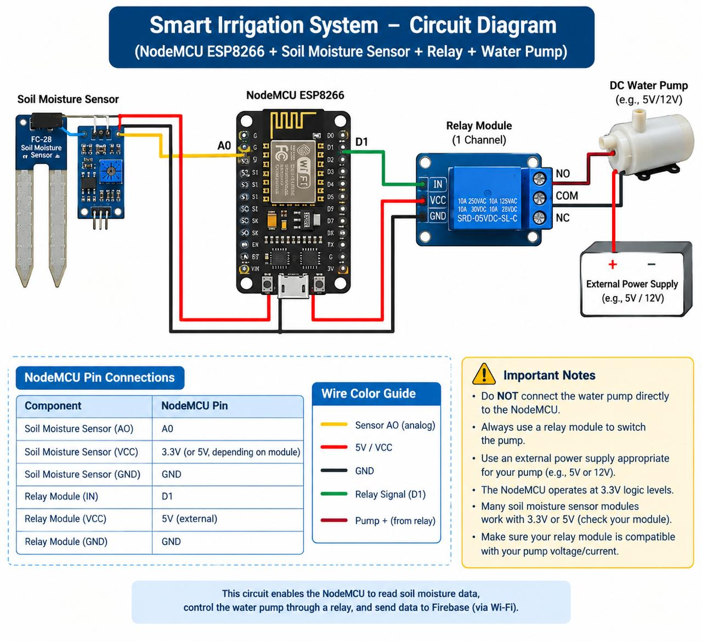

# Smart Irrigation System

An Arduino-based automatic irrigation system designed to monitor soil moisture and control a water pump based on the moisture level of the soil.

## 📌 Project Overview

The Smart Irrigation System is an IoT/embedded-system project that helps automate the irrigation process. A soil moisture sensor continuously measures the moisture level in the soil. The Arduino processes the sensor reading and controls a water pump through a relay module.

The objective is to provide water to the plants when the soil becomes dry and stop irrigation when sufficient moisture is detected.

## 🎯 Objectives

* Monitor soil moisture continuously.
* Automate the irrigation process.
* Reduce unnecessary water usage.
* Minimize manual intervention.
* Control the water pump according to soil conditions.
* Demonstrate the use of sensors, microcontrollers, and relay-based control.

## ⚙️ How It Works

The system follows this basic process:

**Soil Moisture Sensor → Arduino Uno → Relay Module → Water Pump**

1. The soil moisture sensor measures the moisture level.
2. The sensor sends an analog signal to the Arduino.
3. Arduino compares the sensor reading with a predefined threshold.
4. If the soil is relatively dry, Arduino activates the relay.
5. The relay switches the water pump ON.
6. When sufficient moisture is detected, Arduino switches the relay OFF and stops the pump.

## 🔧 Hardware Components

* Arduino Uno
* Soil Moisture Sensor
* 1-Channel Relay Module
* DC Water Pump
* External DC Power Supply
* Jumper Wires
* Breadboard (optional)

## 💻 Software & Technologies

* Arduino IDE
* Embedded C/C++
* Arduino Uno
* Analog Sensor Interfacing
* Relay-Based Control
* Basic IoT/Automation Concepts

## 🔌 Pin Connections

| Component                | Arduino Connection |
| ------------------------ | ------------------ |
| Soil Moisture Sensor VCC | 5V                 |
| Soil Moisture Sensor GND | GND                |
| Soil Moisture Sensor AO  | A0                 |
| Relay VCC                | 5V                 |
| Relay GND                | GND                |
| Relay IN                 | D7                 |

## 📊 Control Logic

```text
              Start
                ↓
       Read Soil Moisture
                ↓
      Compare With Threshold
           ↙           ↘
       Soil Dry     Moisture OK
          ↓              ↓
      Pump ON         Pump OFF
          ↓              ↓
          └──────┬───────┘
                 ↓
          Read Again
```

## 🖼️ Circuit Diagram

The circuit diagram shows the connections between the Arduino, soil moisture sensor, relay module, and water pump.



## 📁 Project Structure

```text
Smart-Irrigation-System/
│
├── Arduino_Code/
│   └── Smart_Irrigation_System.ino
│
├── Circuit_Diagram/
│   └── circuit_diagram.png
│
└── README.md
```

## 🚀 Future Improvements

The system can be further enhanced by adding:

* LCD/OLED display for moisture readings.
* Mobile application monitoring.
* IoT/cloud connectivity.
* Weather-based irrigation control.
* Multiple soil moisture sensors.
* Water-level monitoring.
* Data logging and analytics.

## ⚠️ Note

The moisture threshold should be calibrated according to the actual sensor, soil type, and growing conditions. The water pump should use an appropriate external power supply rather than being powered directly from an Arduino GPIO pin.

## 📚 Learning Outcomes

This project provides practical experience in:

* Arduino programming
* Sensor interfacing
* Analog data acquisition
* Relay control
* Embedded-system development
* Basic automation
* Hardware-software integration
